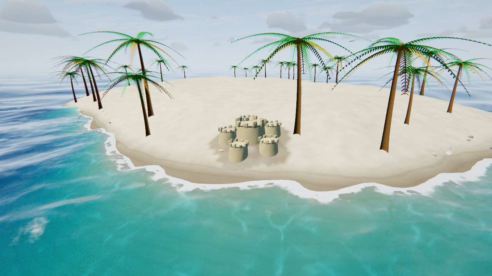
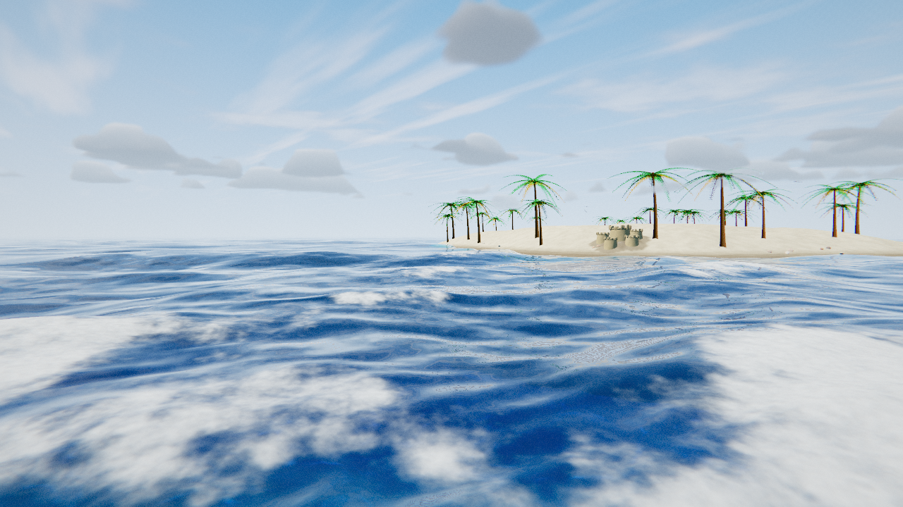

<div align="center">

# 🌊 WaterThreeJS

**A fully procedural, real-time ocean and interactive sandcastle beach built with Three.js — above and below the surface. No textures, no asset downloads: the waves, sky, caustics, sand and castles are all generated in code.**

[English](README.md) · [简体中文](README.zh-CN.md)

[](https://threejs.org/)
[](https://www.khronos.org/webgl/)
[](https://vitejs.dev/)
[](LICENSE)
[](#-contributing)



</div>

## 📖 Overview

WaterThreeJS is a real-time WebGL scene: a spectral ocean that reads as water above *and* below the surface, wrapped around a procedural sand island you can build sandcastles on. Every visual is analytic shader math or generated geometry — there are no image files, no environment maps and no downloaded assets.

The sand is a real simulation, not a decoration: sand carries a moisture value, slumps toward a repose angle when dry, clings near-vertical when wet, and is slowly washed away by the swash.

## ✨ Features

### 🌊 Ocean surface
- **Spectral Gerstner wave field** on a **polar LOD grid** — dozens of waves from long swell down to fine chop, generated with deep-water dispersion (`ω = √(g·k)`) so long waves travel faster than short ones.
- **Screen-space reflections** marched through the pre-water colour/depth buffer, so the island and anything above water is mirrored on the surface.
- **Two cascades of detail normals** faded by the screen-space ray differential, so ripples survive to the horizon instead of aliasing into shimmer.
- Physically-based shading: Schlick **Fresnel**, **Beer–Lambert** refraction, **subsurface scattering** on back-lit crests, GGX **sun glints** (with specular anti-aliasing) and **layered foam**.

### 🏝️ Shore, island & sand simulation
- A sand **island heightfield** rises from seabed through the waterline to dry dunes, with wet/dry sand blended across the beach.
- **Moisture-driven thermal collapse**: dry sand slumps to a ~32° repose angle, damp sand holds a near-vertical face; the sea erodes wet sand more slowly than dry.
- **Interactive sandcastle builder**: bucket-poured towers, raise/dig/smooth/wet/dry brushes, crenellated instanced turrets, save/load and undo.
- A world-space **foam & wetness field** advects foam behind breaking crests and leaves a drying wet mark where the swash ran.

### 🌴 Life & atmosphere
- Tall **coconut palms** with pinnate, drooping fronds, coconuts and a few yellowing old fronds; they sway with the sea state.
- **Gulls** circling on tilted elliptical orbits, **scallop shells** along the beach, plantable **flags** whose cloth ripples in the wind.
- **Procedural audio** (WebAudio, zero files): surf that breathes with the wave sets and wind that rises with the storm.
- **Volumetric clouds** raymarched at half-res with temporal reprojection, self-shadowing and a backlit silver lining — the same clouds cast drifting shadows on the sea.

### 🎬 Rendering pipeline
- HDR (half-float) rendering with a separate refraction pass and depth textures, **MSAA** on the render targets and a device-pixel-accurate render scale.
- Post: threshold **bloom**, underwater **god-rays**, **ACES** filmic tone-mapping, film grain, chromatic aberration and vignette.
- Six one-click **cinematic presets** — *Tropical Noon, Golden Hour, Crimson Sunset, Blue Hour, Clear Dawn, Stormy Seas*.
- **Underwater**: Snell's window, raymarched volumetric light, caustics on the seabed and marine-snow particles.



## 🚀 Getting Started

**Requirements:** Node.js 18+ and a WebGL2-capable browser (Chrome, Edge, Firefox, Safari). The scene targets desktop GPUs.

```bash
# install dependencies
npm install

# start the dev server (opens http://localhost:5173)
npm run dev
```

Build for production:

```bash
npm run build      # outputs to dist/
npm run preview    # serve the production build
```

On Windows you can also double-click **`start-dev.bat`**, which installs dependencies on first run and launches the dev server.

## 🎮 Controls

| Input | Action |
| --- | --- |
| **Drag** | Orbit the camera |
| **Scroll** | Zoom |
| **Right-drag / two-finger drag** | Pan (descend below the surface) |
| **Double-click the sea** | Drop a floating body (`Shift` = cube) |
| **Drag a body** | Move and fling it |
| **B** | Toggle sandcastle build mode |
| **C** | Crouch to eye level beside the castles (depth of field) |
| **H** | Show / hide the full control guide |
| **Ctrl + Z** | Undo the last sculpt stroke |
| **Space** | Freeze the simulation clock |

The top-right **GUI** controls waves, time of day, surface, colour, foam, floating bodies, underwater and post. A **Performance** (性能 / 画质) folder holds MSAA level, render scale and adaptive quality; the **Expert mode** (专家模式) toggle hides the deep-dive folders for a first visit.

## 🧠 How It Works

Everything runs on **WebGL2 + GLSL** through Three.js. There is no WebGPU, no compute shaders and no FFT — the ocean is analytic shader math, which is part of why it runs in any browser with zero assets.

### Rendering pipeline

Each frame is a short chain of passes into **half-float (HDR)** targets, tone-mapped exactly once at the end:

1. **Refraction pass** — sky + seabed + island (everything below the surface) into an HDR target with a depth texture.
2. **Scene pass** — the full scene including the water surface; the water shader reads the refraction colour/depth.
3. **Volumetric clouds** — a low-res raymarch composited into the HDR buffer before tone-mapping.
4. **Post** — underwater absorption + god-rays, threshold bloom, ACES tone-map and sRGB encode.

### Waves

The surface is a summed **Gerstner** field evaluated per-vertex on a **polar LOD grid** (rings whose radii grow geometrically, so a cell is always ~3–4 % of the view distance: ~0.4 m under the camera, ~150 m at the horizon). The harmonic table is authored on the CPU from a **two-peak JONSWAP spectrum** — a swell peak plus a wind-sea peak set by wind speed — and consumed by the vertex shader, the beach/seabed shaders *and* the CPU buoyancy solver.

The same summation yields the **analytic surface normal** and the **Jacobian determinant** of the horizontal displacement: where the Jacobian goes negative the surface is pinching — a breaking crest — which is exactly where foam is seeded.

### Water shading

- **Beer–Lambert** transmittance (`exp(-ABSORB/clarity · thickness)`) gives the turquoise-to-deep-blue gradient, with the refracted seabed showing through.
- **Schlick Fresnel** blends refraction into reflection toward grazing angles; **GGX** sun glints widen with distance and are anti-aliased against screen-space normal variance.
- Reflections are **screen-space** ray-marched, falling back to the shared analytic atmosphere so the reflected horizon always matches the real sky.

### Sandcastle simulation

The beach is a 512² sculpt heightfield (~1 m cells), updated with dirty-rect texture uploads. Each cell carries a **moisture** value that drives a thermal-collapse step: dry sand relaxes toward its repose angle and slumps, wet sand clings and holds a near-vertical slope. The sea erodes any sand inside the swash band, faster when it's dry. Crenellated towers are instanced props seated on the heightfield, and a shared `heightAt()` keeps the visual, the buoyancy and the erosion in agreement.

### Volumetric clouds

A true raymarch through a camera-following high-altitude slab, rendered at half resolution and cleaned up with temporal reprojection. Lighting per sample uses a short exponential light-march for self-shadowing, a Beer–Powder term on thin edges and a 3-octave multi-scattering approximation, with a dual-lobe Henyey–Greenstein phase for the backlit silver lining.

## 🏗️ Project Structure

```
index.html            Boot screen, HUD, canvas
src/
  main.js             Renderer, camera, controls, render passes, immersion logic
  Sky.js              Camera-locked atmosphere dome
  Ocean.js            Gerstner surface mesh + full water shader (+ CPU height fn)
  Floor.js            Sandy seabed with dunes + animated caustics
  Island.js           Sand island heightfield: beach, wet/dry sand, caustics, sculpt
  FoamField.js        World-space foam & wetness field (advected, clipmap window)
  FloatingBodies.js   Buoyant dropped primitives: bob, tilt, terrain collision
  Sandcastles.js      Instanced turrets: pour, stack, tilt, slump, wash away
  Bucket.js           The toy bucket prop — tips over to pour a shaped pile
  PalmTrees.js        Instanced palms — curved trunk + drooping, wind-swayed crown
  Birds.js            Procedural gulls on tilted elliptical orbits
  Audio.js            WebAudio surf + wind, tracking the sea state (no files)
  Clouds.js           Volumetric sky clouds — box-confined raymarch, low-res
  Post.js             Underwater volumetrics + cloud composite + bloom + ACES
  Particles.js        Marine-snow point field
  shaders/common.js   Shared GLSL: noise, atmosphere, Gerstner, caustics, tint
```

Everything outputs **linear HDR**; tone-mapping happens once in the final composite so reflections, refraction and bloom stay energy-consistent.

## 📋 Requirements

- A **WebGL2**-capable browser (Chrome, Edge, Firefox, Safari).
- A desktop GPU is recommended. On lighter hardware, reduce the wave grid resolution in `src/Ocean.js` and the god-ray step count in `src/Post.js`.

## 🤝 Contributing

Issues and pull requests are welcome. Please keep changes focused and consistent with the existing procedural, asset-free approach.

## 📄 License

Released under the **MIT License**. © 2026 **skywalkerqqq**. See [LICENSE](LICENSE).
